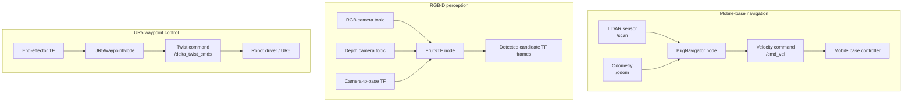

# Krishi CoBot: ROS 2 Navigation & RGB-D Perception

A set of ROS 2 Python nodes reconstructed and cleaned from the author's e-Yantra Robotics Competition (e-YRC) Krishi CoBot project material.

The repository groups three related robotics modules:

1. **Mobile-base navigation** using LiDAR scans and odometry, with waypoint tracking and a simple obstacle-triggered wall-following heuristic.
2. **RGB-D perception** using OpenCV colour segmentation, depth sampling and TF2 frame publication for candidate fruit detections.
3. **UR5 end-effector waypoint control** using TF pose feedback and position/orientation error.

> **Reconstruction and validation status:** The supplied source was available as PDF printouts/screenshots rather than the original source tree. The Python files have been reorganized and cleaned for readability. Syntax checks pass, but the nodes have not been validated on the original robot, camera, simulator or manipulator. This repository does not claim a complete, tested robot stack.

## Project at a glance

| Area | Implementation | Main interfaces |
|---|---|---|
| Navigation | LiDAR proximity check, odometry-based waypoint tracking, obstacle-triggered wall-following heuristic | `/scan`, `/odom` → `/cmd_vel` |
| Perception | HSV/spatial masking, contour candidates, depth ROI estimate, camera-to-base transform | RGB + depth image topics → TF frames |
| Manipulator | Sequential waypoint controller with TF pose feedback and quaternion orientation error | `base_link` + `ee_link` TF → `/delta_twist_cmds` |

## Architecture



The diagram shows the software data flow represented by these nodes. It does not imply that the three modules were integrated and demonstrated together.

## Repository layout

```text
krishicobot-ros2/
├── README.md
├── docs/
│   ├── architecture.md
│   ├── reconstruction-notes.md
│   └── testing-and-validation.md
└── krishicobot/
    ├── package.xml
    ├── setup.py
    ├── setup.cfg
    ├── resource/
    ├── config/
    └── krishicobot/
        ├── __init__.py
        ├── bug_navigator.py
        ├── fruit_tf_detector.py
        └── ur5_waypoint_controller.py
```

## Requirements

- A ROS 2 installation with a sourced environment (the exact ROS 2 distribution used in the original task was not established by the supplied PDFs).
- `rclpy`, `geometry_msgs`, `nav_msgs`, `sensor_msgs`.
- `cv_bridge`, `tf2_ros`, `tf2_geometry_msgs`.
- Python packages: NumPy, OpenCV and SciPy.

Install ROS packages using the package manager/rosdep appropriate to your ROS 2 distribution. On Ubuntu-based ROS 2 installations, the following workspace workflow is a starting point.

## Build and run

Create a workspace and place the ROS package under `src`:

```bash
mkdir -p ~/krishi_ws/src
cp -r krishicobot ~/krishi_ws/src/
cd ~/krishi_ws

source /opt/ros/$ROS_DISTRO/setup.bash
rosdep install --from-paths src --ignore-src -r -y
colcon build --symlink-install
source install/setup.bash
```

Check that the expected topics and transforms exist before launching a node:

```bash
ros2 topic list
ros2 topic echo /odom
ros2 topic echo /scan
ros2 run tf2_ros tf2_echo base_link camera_link
```

### 1. Mobile-base navigation

```bash
ros2 run krishicobot bug_navigator
```

Expected interfaces:
- Subscribes to `/scan` and `/odom`.
- Publishes velocity commands to `/cmd_vel`.
- Uses example waypoints embedded in the source file.

**Before running:** replace the example waypoint coordinates with coordinates appropriate to the robot's map, confirm the velocity controller subscribes to `/cmd_vel`, and test in simulation or with the drive wheels safely raised before floor operation.

### 2. RGB-D candidate perception

```bash
ros2 run krishicobot fruit_tf_detector --ros-args -p show_image:=true
```

Optional parameters:
- `color_topic` (default `/camera/image_raw`)
- `depth_topic` (default `/camera/depth/image_raw`)
- `target_frame` (default `base_link`)
- `show_image` (default `false`)
- `team_id` (default `3614`)

**Before running:** confirm RGB/depth topic names, depth encoding and units, camera intrinsics, frame IDs, transform availability and HSV thresholds.

### 3. UR5 waypoint controller

The controller defaults to `enable_motion:=false`. In this mode it suppresses computed motion commands and publishes zero-velocity commands.

```bash
ros2 run krishicobot ur5_waypoint_controller
```

The source includes example waypoint poses and assumes a twist command interface at `/delta_twist_cmds`.

**Do not enable motion** until the waypoint coordinate frame, end-effector frame, quaternion convention, driver command semantics, workspace and emergency-stop procedure have been checked by a qualified supervisor. Only then should the `enable_motion` parameter be considered.

## Configuration and tuning checklist

| Parameter / assumption | Where to check | Why it matters |
|---|---|---|
| Waypoint coordinates | `bug_navigator.py` | Coordinates are map-specific |
| Obstacle threshold and gains | `bug_navigator.py` | Sensor noise and robot dynamics vary |
| Camera intrinsics | `fruit_tf_detector.py` | Required for pixel-to-3D projection |
| HSV lower/upper bounds | `fruit_tf_detector.py` | Lighting and fruit appearance affect segmentation |
| Depth encoding and units | Camera driver / perception node | Incorrect units produce incorrect positions |
| TF frame names | Launch/robot configuration | Transforms must match the actual robot |
| UR5 waypoint poses | `ur5_waypoint_controller.py` | Poses are robot/workspace-specific |
| Twist topic and semantics | UR driver configuration | Incorrect assumptions can cause unsafe movement |

## Limitations

- The navigation node implements a simple obstacle-triggered wall-following heuristic. It is **not** a complete Tangent Bug algorithm, SLAM system, costmap planner or globally optimal path planner.
- The fruit detector uses colour and region heuristics. It is not a trained fruit classifier and can produce false positives/negatives.
- The camera intrinsics and example waypoints are task-specific values transcribed from the supplied material; they must be calibrated/verified.
- The RGB-D pipeline assumes usable alignment between colour and depth images. The original camera setup was not included.
- The UR5 controller is a basic Cartesian twist controller, not a collision-aware trajectory planner.
- No launch files, URDF, simulator world, camera calibration package, bag files or original e-YRC workspace were included in the supplied material.
- Syntax validation is not equivalent to ROS runtime, simulation or hardware validation.

## Validation status

See [`docs/testing-and-validation.md`](docs/testing-and-validation.md) for what has been checked and what remains to be tested.

## Source and attribution

Project context: e-YRC 2025–26 Krishi CoBot task. The supplied source PDF contains an e-YRC software notice describing the software as provided on an “AS IS WHERE IS BASIS.” This repository does not include original task assets. Confirm the applicable organizer terms and permissions before publishing or redistributing source-derived code.
