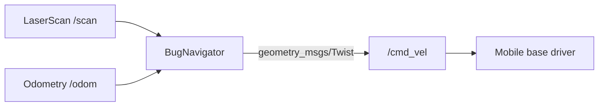
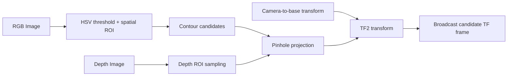
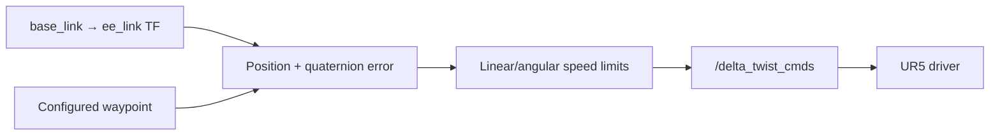

# Architecture and data flow

## 1. Mobile-base navigation

The node estimates the robot pose from odometry, checks valid LiDAR ranges against a configurable minimum obstacle distance, and selects either direct waypoint tracking or a simple wall-following response. Waypoints are currently hard-coded examples.

## 2. RGB-D perception

The detector finds colour/region candidates, samples nearby depth, projects the pixel/depth measurement using camera intrinsics and transforms the point into the target frame.

## 3. UR5 waypoint controller

The controller moves through a sequence of example poses and pauses briefly when a waypoint tolerance is met. Motion is disabled by default in this repository.

## Integration boundary

These are three separate ROS nodes. The supplied material does not establish that all three were launched together or that their interfaces were integrated into one complete deployed system.
